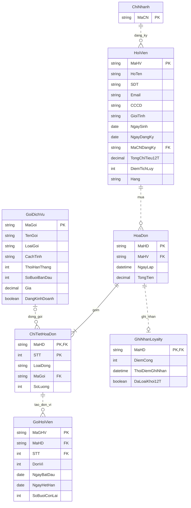

# ERD Module B

Bản hiện hành GD1-11, đồng bộ [thiết kế logic](thiet-ke-logic.md). Chỉ hiện phần dữ liệu A/D cần tham chiếu.

GoiHoiVien có FK ghép (MaHD,STT), AK (MaHD,STT,DonVi). SDT/CCCD của HoiVien là AK. Một dòng gói đã thanh toán tạo đúng SoLuong gói; dòng sản phẩm tạo 0. Hóa đơn đã hoàn tất có đúng một ghi nhận Loyalty. Hội viên và mã danh mục của gói đã mua suy ra qua hóa đơn/dòng; vGoiHoiVien là view đọc, không phải thực thể lưu thêm. Ràng buộc thời gian/điểm/hạng ở thiết kế logic.
