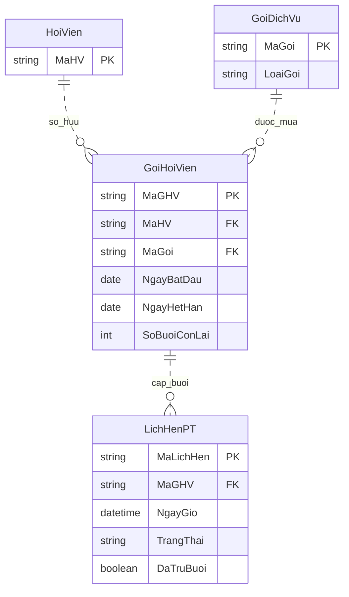

# Gói PT và liên kết lịch hẹn

Thiết kế liên module B–C cho GD1-03, chốt ngày 08/11/2026. Đây là phần thiết kế quyền lợi PT; ERD và thiết kế logic đầy đủ B đã hoàn thiện ở GD1-11.

## Mua thêm

- Mỗi lần mua tạo một `GoiHoiVien` với `MaGHV` duy nhất. Cùng `MaGoi` danh mục có thể được mua nhiều lần, mỗi lần có mã riêng.
- Gói PT bắt đầu ngày mua, số buổi và hạn riêng; dùng được ngay khi đủ điều kiện đặt lịch. Không cần chờ gói cũ hết buổi hoặc hết hạn.
- Giữ quy ước hạn PT hiện có: ngày mua cộng thời hạn 3/6/12 tháng, dùng đến hết ngày hết hạn; thiếu ngày tương ứng thì lấy cuối tháng đích. Quy tắc này riêng với Gym/Yoga nối tiếp ở quyết định #9.
- Không chuyển buổi sang gói mới hoặc thay hạn gói cũ. Hết hạn thì số buổi chưa dùng không còn quyền đặt lịch; giữ dữ liệu để truy vết, không xóa gói hoặc tự ghi số dư về 0.
- Điều kiện mua kèm quyền vào cổng vẫn theo #8. Gói PT không cấp quyền vào.

## Dữ liệu và quan hệ

```text
vGoiHoiVien(MaGHV, MaHV, MaGoi, NgayBatDau, NgayHetHan, SoBuoiConLai) — giao diện đọc B
LichHenPT(MaLichHen, MaGHV, MaNV, MaCN, NgayGio, ThoiDiemDat,
          TrangThai, DaTruBuoi, LyDoKetThuc) — C
```

GoiHoiVien.MaGHV là khóa chính; MaHV/MaGoi lấy qua vGoiHoiVien từ hóa đơn/dòng theo GD1-11. MaGHV xác định chủ sở hữu, gói danh mục và quyền lợi của đúng một lần mua. Không đổi chủ sở hữu, loại gói hoặc khoảng hiệu lực của gói đã bán trong luồng nghiệp vụ hiện tại; cập nhật số buổi chỉ qua giao dịch tiêu thụ hợp lệ. Đổi giá/ngừng bán danh mục không làm mất quyền lợi đã mua; không đổi LoaiGoi của mã đã được bán.

`LichHenPT.MaLichHen` là khóa chính, `MaGHV` là FK bắt buộc đến GoiHoiVien. Không lưu MaHV trên lịch: MaGHV đã xác định MaHV, lưu cả hai sẽ tạo phụ thuộc hàm không khóa `MaGHV → MaHV` trong quan hệ lịch. Chủ lịch/đánh giá/tra cứu lịch sử hội viên đều lấy qua phép nối gói đã mua.



Mỗi gói đã mua có 0..N lịch, mỗi lịch dùng đúng một gói. Sơ đồ này là phần liên kết PT; các thuộc tính còn lại của lịch và ERD đầy đủ C ở [thiết kế C](../c/erd.md).

## Giữ chỗ và số buổi khả dụng

Với một MaGHV:

```text
SoLichGiu = COUNT(LichHenPT có cùng MaGHV,
                  TrangThai = 'Đã đặt' và DaTruBuoi = 0)
SoBuoiKhaDung = SoBuoiConLai - SoLichGiu
0 <= SoLichGiu <= SoBuoiConLai
```

Không lưu thêm SoLichGiu. Số giữ chỗ bao gồm lịch đã đến giờ nhưng tác vụ chưa trừ; nếu bỏ chúng sẽ cho đặt vượt quyền lợi. Lịch đã trừ không bị đếm lần nữa.

Khi đặt, chỉ xét gói của hội viên, loại PT, `NgayBatDau <= NgayHen <= NgayHetHan` và SoBuoiKhaDung > 0. Chọn theo NgayHetHan tăng dần, cùng hạn thì MaGHV tăng dần. Ghi MaGHV lên lịch và giữ nguyên liên kết này, kể cả có gói mới hoặc buổi của gói cũ được giải phóng sau đó. Không hỗ trợ sửa gói/giờ của lịch tại chỗ; muốn đổi thì hủy đúng hạn và đặt lịch mới.

## Giao dịch

Mọi thao tác đặt/hủy/trừ phải kiểm tra lại trạng thái gói/lịch tại lúc ghi nhận. Đặt lịch phải xét chức vụ/chi nhánh theo lịch sử, gồm giai đoạn chờ. Hai yêu cầu không được giữ chung buổi cuối hoặc trùng khung PT; dữ liệu đọc trước đó chỉ là dự kiến. Các thay đổi liên quan thành công hoặc hoàn tác cùng nhau.

| Thao tác | Thay đổi nguyên tử | Điều kiện |
|---|---|---|
| Đặt | Thêm lịch có MaGHV, Đã đặt, DaTruBuoi = 0; không giảm số buổi | Kiểm tra lại điều kiện PT/chi nhánh; tính lại khả dụng, chủ sở hữu, loại/hạn gói và khung PT. Gói hết khả dụng thì thử ứng viên hợp lệ tiếp theo; xung đột khung PT thì rollback |
| Hủy đúng hạn | Chuyển Hủy, lý do hủy đúng hạn; cờ vẫn 0, số buổi không đổi | Còn ít nhất hai giờ, lịch của đúng hội viên; kết thúc giữ chỗ do lịch không còn Đã đặt |
| Đến giờ | Giảm SoBuoiConLai đúng 1 và đặt cờ 1; giữ Đã đặt chờ kết quả | Lịch đến hạn chưa hủy, cờ 0; gói đúng MaGHV, còn số dư. Hạn xét tại NgayGio của lịch, kể cả tác vụ chạy bù sau ngày hết hạn |
| Hoàn thành/vắng mặt | Chuyển trạng thái và lý do tương ứng, giữ cờ 1 | Đã trừ thành công; không giảm buổi lần nữa |

Giao dịch lỗi phải hoàn tác cả lịch và số dư. Chạy lại tác vụ thấy cờ 1 thì bỏ qua. Bảo vệ quyền sở hữu khi đặt/hủy/đánh giá qua vGoiHoiVien.MaHV. Không cho xóa gói có lịch tham chiếu, không chuyển MaGHV của lịch; các FK và hạn chế sửa phải được thực thi ở GĐ2.

## Tình huống phải đúng

| Tình huống | Kết quả |
|---|---|
| Gói A còn 2 buổi, hết 15/11; B còn 10, hết 08/02 năm sau; đặt 12/11 | Giữ A nếu còn khả dụng |
| Cùng các gói đó, đặt 20/11 | Chọn B, vì A không đủ hạn tại ngày hẹn |
| A còn 2 buổi nhưng đã có 2 lịch chưa trừ | Khả dụng A = 0; chọn B hoặc từ chối nếu không có gói khác |
| Hai yêu cầu cùng nhắm một buổi cuối | Sau khi kiểm tra lại, chỉ một lịch giữ được buổi đó |
| Hủy một lịch A trước ít nhất hai giờ | Khả dụng A tăng 1; SoBuoiConLai chưa đổi |
| Tác vụ trừ lịch A rồi chạy lại | Chỉ A giảm 1, B không đổi, chạy lại không giảm thêm |
| Lịch A đến hạn nhưng tác vụ chưa chạy | Vẫn tính giữ chỗ, không bán lại quyền đặt buổi đó |
| Lịch thuộc ngày cuối hạn; tác vụ chạy bù hôm sau | Trừ A đúng một lần vì ngày hẹn nằm trong hạn; không đổi sang B |
| Mua thêm B khi A còn hạn nhưng hết buổi | B dùng được từ ngày mua |
| Người khác gửi mã gói hoặc mã lịch của hội viên | Từ chối; không thay đổi giữ chỗ/số dư |

Các tình huống được đối chiếu bằng mô hình giữ/trừ buổi trong lần xử lý GD1-03; chưa phải kiểm thử giao dịch SQL Server.

**GD1-10 — kỳ hoa hồng:** từ chối thêm/đổi nguồn vào kỳ đã chốt. Không sửa/xóa MaNV, MaCN, NgayGio, TrangThai của buổi đã chốt. Chốt A và ghi nguồn C phải duy trì điều kiện này cả khi diễn ra đồng thời; xem [thiết kế A](../a/thiet-ke-logic.md).

**Ánh xạ GD1-11:** GoiHoiVien cơ sở lưu MaGHV, MaHD, STT, DonVi, ngày và số dư; MaHV/MaGoi trong giao diện đọc trên đây lấy từ quan hệ dẫn xuất vGoiHoiVien qua hóa đơn/dòng, không phải FK/cột lưu lặp trên gói. Lược đồ cơ sở và ERD hiện hành tại [thiết kế B](thiet-ke-logic.md) thay thế phần minh họa gói trước GD1-11; giữ nguyên quy tắc PT/điểm.
