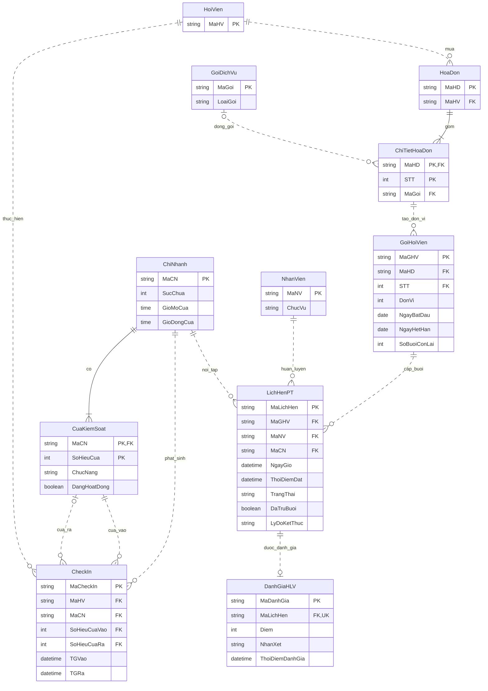

# ERD Module C

Bản hiện hành sau GD1-03. Sơ đồ PNG trước đây chưa có liên kết gói đã mua; dùng sơ đồ này khi ghép ERD tổng. Thực thể A/B chỉ hiện cột cần tham chiếu trong hợp đồng; quy tắc ngoài sơ đồ ở [business-rules.md](business-rules.md).

- Hai FK cửa của CheckIn là cặp `(MaCN, SoHieuCuaVao)` và `(MaCN, SoHieuCuaRa)`; cửa ra có thể rỗng khi đang mở hoặc tự đóng.
- MaGHV bắt buộc, chỉ gắn gói loại PT. MaHV của lịch suy ra từ gói, không lưu trùng; gói có thể không có lịch hoặc có nhiều lịch, kể cả lịch đã hủy.
- Quan hệ hội viên–lịch được thể hiện qua gói đã mua. Mỗi lịch thuộc đúng một hội viên. Tra cứu lịch sử và kiểm tra chủ đánh giá phải nối qua GoiHoiVien.
- Số giữ chỗ, chọn gói đủ hạn, trừ đúng một lần và yêu cầu cập nhật nhất quán được mô tả trong [thiết kế PT B–C](../b/goi-pt.md).

GD1-11: MaHV/MaGoi đọc qua vGoiHoiVien từ hóa đơn/dòng; FK lịch vẫn tới MaGHV bảng cơ sở. FK dòng là (MaHD,STT); AK đơn vị là (MaHD,STT,DonVi).
