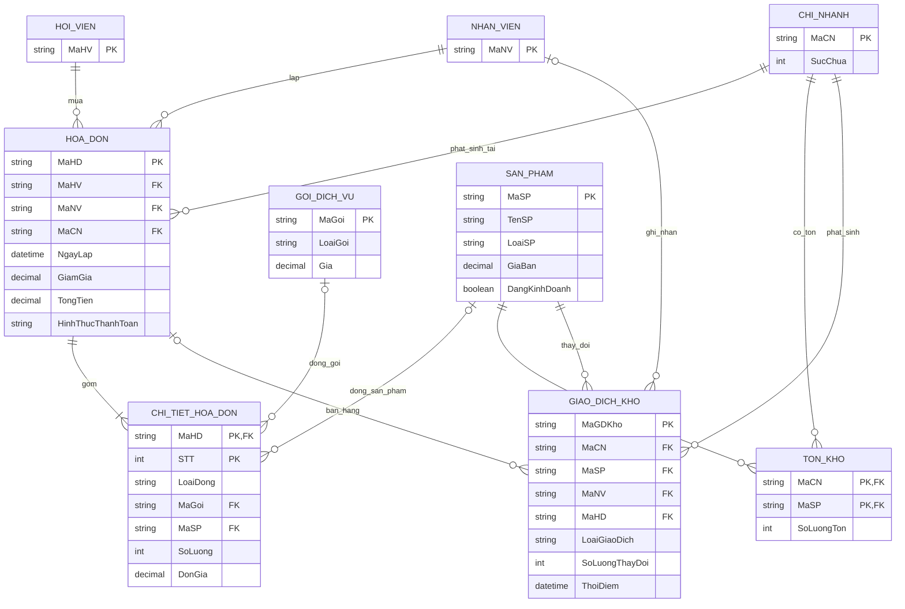

# Module D — Mô hình quan niệm và ràng buộc

ERD dưới đây biểu diễn dữ liệu do D sở hữu bằng Mermaid. `HoiVien`, `NhanVien`, `ChiNhanh` và `GoiDichVu` là thực thể tham chiếu từ B/A; các thuộc tính hiển thị chỉ gồm khóa/cột đã công bố trong hợp đồng. `CheckIn` là dữ liệu đọc từ C cho báo cáo, không phải bảng D sở hữu.

Bản xuất đã kiểm tra: [ERD SVG](erd.svg) (Mermaid 10.9.3).

`GiaoDichKho` là nhật ký nhập/điều chỉnh/trừ kho; `SoLuongThayDoi` lưu số dương khi nhập và số âm khi xuất. Với giao dịch bán, `MaHD` được điền để đối chiếu hóa đơn. Dòng ChiTietHoaDon giữ SoLuong và DonGia chụp lúc bán; ThanhTien trước giảm được tính khi đọc, không lưu trong bảng (GD1-12). GiamGiaDong/DoanhThuDong tính ra theo GD1-08 trong thiết kế logic, không thêm thuộc tính lưu trong ERD.

## Cardinality và ý nghĩa

- Một hội viên, nhân viên hoặc chi nhánh có thể liên quan nhiều hóa đơn; mỗi hóa đơn thuộc đúng một hội viên, nhân viên lập và chi nhánh.
- Một hóa đơn đã thanh toán có ít nhất một dòng chi tiết. Mỗi dòng tham chiếu đúng một gói hoặc một sản phẩm.
- `TonKho` là quan hệ kết hợp nhiều-nhiều giữa sản phẩm và chi nhánh, khóa ghép `(MaCN, MaSP)`.
- Mỗi thay đổi tồn kho được ghi thành một dòng `GiaoDichKho`; số dư hiện hành nằm ở `TonKho` để tra cứu nhanh.
- Số lượng check-in tại chi nhánh theo thời điểm dùng để tính lấp đầy, kết hợp `ChiNhanh.SucChua`.

## Ràng buộc quan niệm chưa thể hiện trọn trên ERD

1. `ChiTietHoaDon` phải có đúng một trong hai khóa tham chiếu `MaGoi`, `MaSP`, tương ứng với `LoaiDong`.
2. Tổng hóa đơn phải cân bằng: TongTien = SUM(ChiTietHoaDon.SoLuong × ChiTietHoaDon.DonGia) − GiamGia; giảm giá từ 0 đến tổng tiền hàng. Phân bổ theo tỷ lệ toàn bộ dòng và chia phần đồng dư theo GD1-08: tổng giảm dòng = GiamGia, tổng doanh thu dòng sau giảm = TongTien. Không trừ giảm giá lần hai khi lập báo cáo.
3. ThanhTien là kết quả truy vấn SoLuong × DonGia, không phải thuộc tính cơ sở; số lượng nguyên dương, đơn giá không âm. Với gói, số lượng thường là 1.
4. Tồn kho của từng sản phẩm tại chi nhánh không được âm; mọi thay đổi số dư, kể cả số dư mở đầu, phải khớp nhật ký giao dịch kho.
5. Mọi sản phẩm trong hóa đơn phải đang kinh doanh và có dòng tồn kho tại chi nhánh lập hóa đơn. Sản phẩm bán không vượt số tồn.
6. `TongTien` là tiền sau giảm giá; điểm/hạng được B cập nhật đúng một lần cho mỗi hóa đơn thành công.
7. Hóa đơn đã thanh toán và các dòng tương ứng không được sửa/xóa/hoàn tiền theo quyết định #16.
8. SucChua là số nguyên dương phục vụ báo cáo; tỷ lệ tại T = 100 × số phiên có TGVao <= T và (TGRa rỗng hoặc TGRa > T) / SucChua. Cho phép tỷ lệ trên 100%, không chặn cổng. Lượt tự đóng và báo cáo tạm tính theo QT-D5/#15.

GD1-13: GiaoDichKho có FK ghép (MaCN,MaSP) tới TonKho, đúng điều kiện cặp kho đã tồn tại trước phát sinh. Bảng ảnh hưởng chi tiết ở thiết kế logic; không suy ra quyền xóa từ dấu − của một ràng buộc miền.
