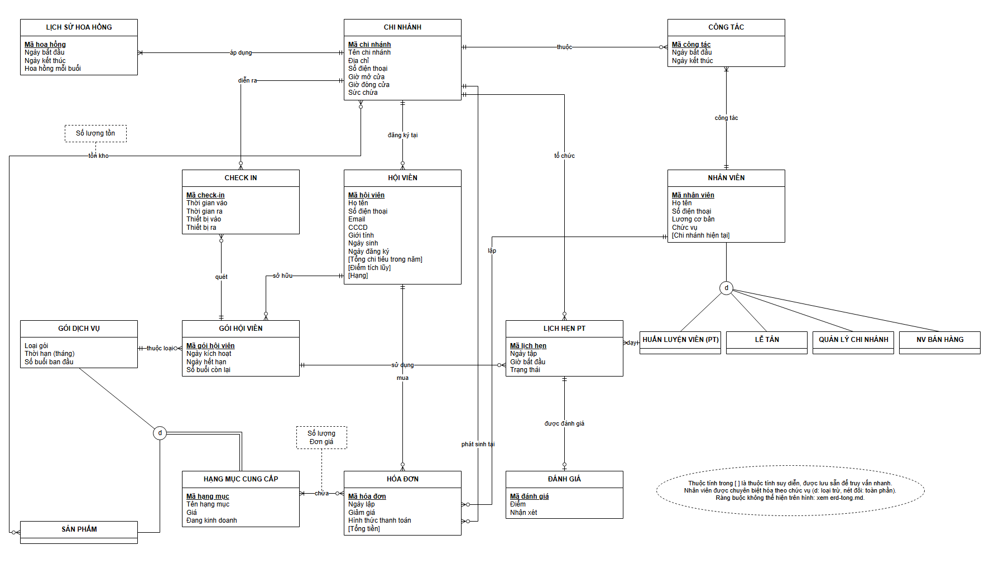

# Thiết kế mức quan niệm — ERD FitLife Hub

Nguồn chỉnh sửa: [erd.drawio](erd.drawio). Ký hiệu giữ theo bản ERD trước của nhóm ([conceptual-diagram.png](conceptual-diagram.png), 10/11/2026):

- Hộp thực thể: tên ở tiêu đề, thuộc tính bên dưới; thuộc tính khóa **gạch chân**; thuộc tính trong `[ ]` là thuộc tính suy diễn (tính được từ dữ liệu khác, được lưu sẵn).
- Bản số theo ký hiệu chân gà: `||` đúng một, `o<` không hoặc nhiều, `|<` một hoặc nhiều, `o|` không hoặc một. Tên mối kết hợp ghi trên đường nối.
- Chuyên biệt hóa: vòng tròn `d` (các lớp con loại trừ nhau); nét đôi từ lớp cha = toàn phần (mỗi bộ của lớp cha thuộc một lớp con).
- Mối kết hợp nhiều–nhiều có thuộc tính riêng: thuộc tính ghi trong hộp nét đứt nối vào đường (**chứa**: số lượng, đơn giá; **tồn kho**: số lượng tồn).

ERD không vẽ khóa ngoại; khóa ngoại xuất hiện khi chuyển sang [lược đồ logic](luoc-do-logic.png).

## Thực thể và mối kết hợp

| Mối kết hợp | Thực thể | Bản số | Ý nghĩa |
|---|---|---|---|
| áp dụng | CHI NHÁNH – LỊCH SỬ HOA HỒNG | 1 – 1..n | Mỗi chi nhánh có các khoảng mức hoa hồng theo thời gian |
| thuộc / công tác | CHI NHÁNH – CÔNG TÁC – NHÂN VIÊN | 1 – 0..n; 1 – 1..n | Lịch sử công tác của nhân viên tại các chi nhánh |
| (chuyên biệt hóa) | NHÂN VIÊN → HUẤN LUYỆN VIÊN (PT), LỄ TÂN, QUẢN LÝ CHI NHÁNH, NV BÁN HÀNG | d, toàn phần | Theo chức vụ, cố định từ lúc tiếp nhận; ở mức logic ánh xạ thành thuộc tính `ChucVu` |
| đăng ký tại | CHI NHÁNH – HỘI VIÊN | 1 – 0..n | Chi nhánh nơi hội viên đăng ký |
| (chuyên biệt hóa) | HẠNG MỤC CUNG CẤP → GÓI DỊCH VỤ, SẢN PHẨM | d, toàn phần | Gói và sản phẩm dùng chung danh mục; ở mức logic gộp một bảng, phân biệt bằng `LoaiHangMuc` |
| sở hữu / thuộc loại | HỘI VIÊN – GÓI HỘI VIÊN – GÓI DỊCH VỤ | 1 – 0..n; 1 – 0..n | Mỗi lần mua gói là một gói hội viên, có mã QR riêng |
| quét / diễn ra | GÓI HỘI VIÊN – CHECK IN – CHI NHÁNH | 1 – 0..n; 1 – 0..n | Hội viên quét mã gói để vào chi nhánh |
| sử dụng / dạy / tổ chức | GÓI HỘI VIÊN, HUẤN LUYỆN VIÊN, CHI NHÁNH – LỊCH HẸN PT | 1 – 0..n mỗi phía | Buổi PT dùng một gói PT, do một PT dạy tại một chi nhánh |
| được đánh giá | LỊCH HẸN PT – ĐÁNH GIÁ | 1 – 0..1 | Mỗi buổi tối đa một đánh giá |
| mua / lập / phát sinh tại | HỘI VIÊN, NHÂN VIÊN, CHI NHÁNH – HÓA ĐƠN | 1 – 0..n mỗi phía | Ai mua, ai lập, lập ở đâu |
| chứa | HÓA ĐƠN – HẠNG MỤC CUNG CẤP | n – n (hóa đơn có 1..n hạng mục) | Thuộc tính: số lượng, đơn giá lúc bán |
| tồn kho | SẢN PHẨM – CHI NHÁNH | n – n | Thuộc tính: số lượng tồn; có bộ nghĩa là chi nhánh bán sản phẩm đó |

## Ràng buộc không thể hiện trên ERD

Các điều kiện đặc tả có nhưng hình không vẽ được. Mức logic viết lại thành ràng buộc có bảng tầm ảnh hưởng (R01–R27) trong [thiết kế logic](thiet-ke-tong.md).

**Chi nhánh và nhân sự**
1. Giờ mở cửa trước giờ đóng cửa trong cùng ngày; sức chứa là số nguyên dương.
2. Các giai đoạn CÔNG TÁC của cùng một nhân viên không chồng nhau về ngày; ngày kết thúc (nếu có) không trước ngày bắt đầu. Thay đổi gửi trong ngày D có hiệu lực từ D+1.
3. Chức vụ của NHÂN VIÊN được gán lúc tiếp nhận và không đổi (đổi chức vụ ngoài phạm vi). [Chi nhánh hiện tại] lấy từ giai đoạn công tác bao phủ hôm nay; không có giai đoạn nào thì nhân viên đã nghỉ việc.
4. Các khoảng LỊCH SỬ HOA HỒNG của một chi nhánh không chồng nhau; mức hoa hồng không âm; mức mới chỉ có hiệu lực từ ngày mai.

**Hội viên, gói, điểm/hạng**
5. CCCD và số điện thoại của hội viên là duy nhất.
6. [Tổng chi tiêu trong năm] = tổng tiền các hóa đơn của hội viên trong năm hiện tại, về 0 đầu năm; [Điểm tích lũy] = tổng phần nguyên (tổng tiền / 100.000) của mọi hóa đơn, không reset; [Hạng] theo ngưỡng Silver < 20 triệu ≤ Gold < 50 triệu ≤ Platinum.
7. GÓI DỊCH VỤ: Gym/Yoga có thời hạn 1/3/6/12 tháng; PT có thời hạn 3/6/12 tháng và số buổi dương; Spa, Vé lượt có đúng 1 lượt, hạn 7 ngày. Giá hạng mục dương.
8. GÓI HỘI VIÊN bắt đầu ngày mua; ngày hết hạn và số buổi còn lại tính từ gói dịch vụ tại lúc mua; số buổi còn lại không âm. Mỗi đơn vị gói trên hóa đơn sinh đúng một gói hội viên.

**Check-in và lịch PT**
9. Chỉ quét vào được bằng gói còn hiệu lực, còn lượt (nếu có giới hạn) và không phải gói PT; vé lượt bị trừ 1 lượt khi vào. Thời gian ra (nếu có) sau thời gian vào.
10. LỊCH HẸN PT dài một giờ, bắt đầu vào giờ tròn, nằm trong giờ mở cửa chi nhánh; trạng thái ∈ {Đã đặt, Hủy, Đã hoàn thành}.
11. Một PT không có hai lịch chưa hủy cùng ngày, cùng giờ; một hội viên cũng vậy.
12. Nhân viên của lịch phải có chức vụ PT và đang công tác tại đúng chi nhánh của lịch vào ngày tập.
13. Gói của lịch là gói PT của hội viên, còn hạn tại ngày tập; số lịch Đã đặt của một gói không vượt số buổi còn lại.
14. Chỉ hủy khi còn ít nhất 2 giờ; tới giờ tập, lịch Đã đặt chuyển Đã hoàn thành và trừ 1 buổi (kể cả hội viên không đến). Lịch của tháng đã qua không được sửa.
15. Chỉ lịch Đã hoàn thành được đánh giá; điểm từ 1 đến 5.

**Hóa đơn và tồn kho**
16. Hóa đơn có ít nhất một hạng mục; tổng tiền = Σ số lượng × đơn giá − giảm giá, với 0 ≤ giảm giá ≤ tổng trước giảm; hình thức thanh toán ∈ {Tiền mặt, VNPay, Thẻ}. Hóa đơn đã thanh toán không sửa, không xóa.
17. Chi nhánh của hóa đơn là chi nhánh nhân viên lập đang công tác tại ngày lập.
18. Số lượng tồn không âm; bán sản phẩm thì chi nhánh phải có bộ tồn kho của sản phẩm đó và đủ hàng, tồn giảm đúng số lượng bán.
