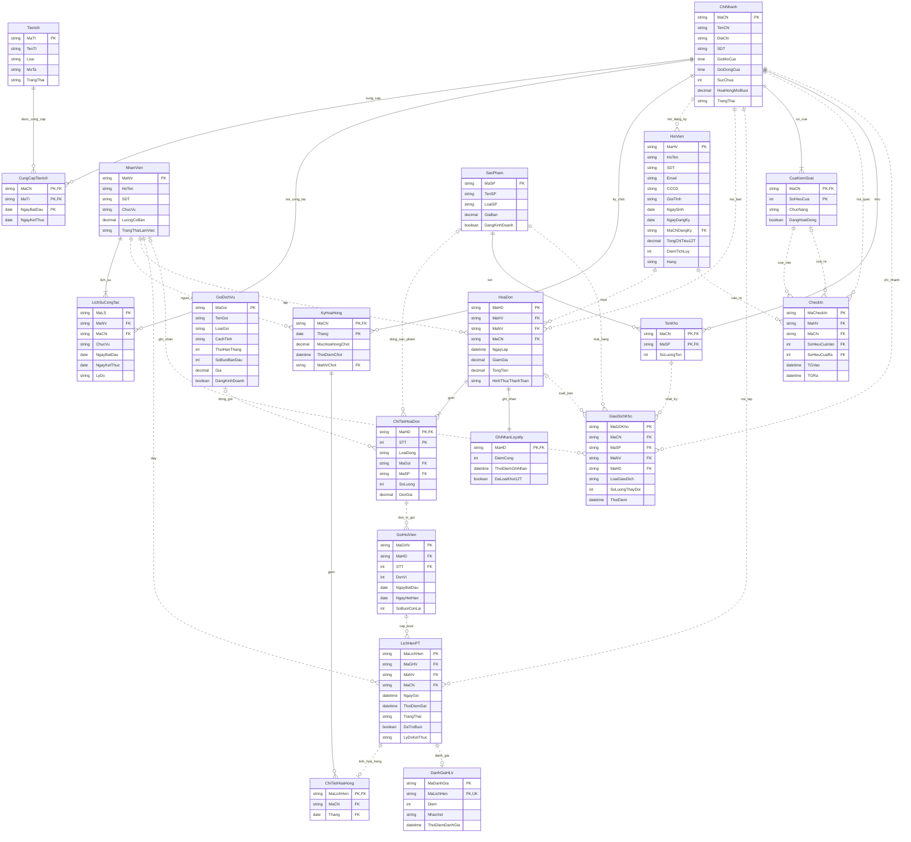

# ERD tổng GĐ1 — A/B/C/D

Bản ghép hiện hành ngày 08/11/2026: 20 thực thể/quan hệ, mỗi thực thể chỉ xuất hiện một lần và lấy thuộc tính từ module sở hữu. Kiểu trên sơ đồ là miền logic, không phải khai báo SQL. [Lược đồ, khóa và ràng buộc tổng](thiet-ke-tong.md).

Bản xuất đã kiểm tra cú pháp và hiển thị bằng Mermaid 10.9.3: [ERD tổng dạng SVG để phóng to](erd-tong.svg).

## Cách đọc và ràng buộc ngoài hình

- Mỗi hóa đơn trong dữ liệu đã thanh toán có ít nhất một dòng và đúng một ghi nhận Loyalty; bản nháp chưa thanh toán không phải bản ghi hoàn tất. Sơ đồ B trước khi ghép dùng 0..1 cho quá trình ghi nhận; bản tổng dùng 1..1 ở trạng thái đã hoàn tất.
- Dòng hóa đơn tham chiếu đúng một trong GoiDichVu/SanPham. Dòng gói tạo đúng SoLuong đơn vị GoiHoiVien; dòng sản phẩm tạo 0. Hai cạnh tùy chọn không cho phép cả hai cùng có hoặc cùng rỗng.
- FK ghép: GoiHoiVien.(MaHD,STT) → ChiTietHoaDon; ChiTietHoaHong.(MaCN,Thang) → KyHoaHong; hai cửa vào/ra của CheckIn dùng (MaCN,SoHieuCuaVao/Ra); GiaoDichKho.(MaCN,MaSP) → TonKho.
- Cửa ra có thể rỗng; có TGRa và không có cửa ra biểu thị tự đóng theo quy ước mô phỏng. GiaoDichKho.MaHD/MaNV có thể rỗng khi không gắn hóa đơn/người ghi; bán hàng phải gắn hóa đơn.
- AK ngoài ký hiệu PK: HoiVien.SDT, HoiVien.CCCD; LichSuCongTac.(MaNV,NgayBatDau); GoiHoiVien.(MaHD,STT,DonVi); DanhGiaHLV.MaLichHen.
- Phân cấp nhân viên loại trừ/toàn phần ánh xạ vào ChucVu; lịch sử lưu ChucVu của từng giai đoạn. Không tạo bản sao thực thể NhanVien cho mỗi module.
- vGoiHoiVien là phép nối dẫn xuất, không phải thực thể lưu thêm. Không có FK CheckIn → lịch PT; PT không cấp quyền vào. Không có quầy kiểm tra dịch vụ.
- Điều kiện theo thời gian, chống trùng lịch, chủ gói, số buổi giữ, bất biến hóa đơn/hoa hồng và tính lấp đầy không thể hiện đủ bằng lực lượng quan hệ; xem bảng ràng buộc tổng.
